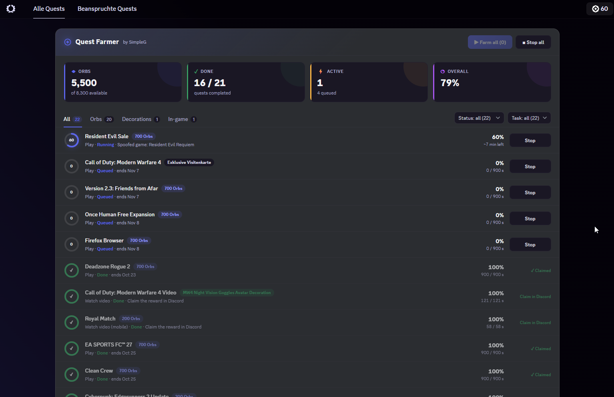

<div align="center">

# ◎ Discord Quest Farmer

**Accept and complete Discord Quests automatically, controlled from a clean dashboard right inside Discord.**


**Build by SimpleG** · [fakecrime.bio/Simpleg](https://fakecrime.bio/Simpleg)

</div>

---

> [!WARNING]
> Using this script violates Discord's Terms of Service. Your account may be restricted or banned.
> **Use it at your own risk.** The author takes no responsibility for any consequences.

---

## 📑 Table of contents

- [Features](#-features)
- [Supported quest types](#-supported-quest-types)
- [Installation & usage](#-installation--usage)
- [The dashboard](#-the-dashboard)
- [Configuration](#%EF%B8%8F-configuration)
- [Console API](#-console-api)
- [How it works](#-how-it-works)
- [Troubleshooting](#-troubleshooting)
- [Changelog](#-changelog)
- [License](#-license)

---

## ✨ Features

| | |
|---|---|
| 📋 **Single file** | One script, pasted into the DevTools console. No build step, no install, no dependencies. |
| ✅ **Farms every quest** | Quests you haven't accepted yet are accepted automatically, then completed. |
| ⚡ **Parallel lanes** | Video and activity quests run at the same time as play and stream quests. |
| 📊 **Dashboard** | Stat tiles for Orbs, completed quests, active quests and overall progress. |
| 🔎 **Filters** | Filter by reward (Orbs, decorations, in-game …), status and task type. Your selection is saved. |
| 🔄 **Live progress** | Progress rings, percentages and remaining time per quest, updated live. |
| 🧭 **Sidebar entry** | Discord's "Quests" entry becomes **Quest Farmer** with a live badge (progress / open quests / ✓). |
| 🧹 **Clean page** | Discord's promo banner and quest grid are hidden, so only the dashboard is shown. |
| 🎨 **Native look** | Uses Discord's own CSS variables, so it matches your theme. |
| ♻️ **Safe to re-run** | Pasting again cleanly replaces the old instance. **Remove** restores Discord exactly as it was. |

---

## 🎮 Supported quest types

| Task | Desktop app | Browser | Notes |
|---|:---:|:---:|---|
| `WATCH_VIDEO` | ✅ | ✅ | Video progress is reported directly |
| `WATCH_VIDEO_ON_MOBILE` | ✅ | ✅ | Same as above |
| `PLAY_ACTIVITY` | ✅ | ✅ | Needs at least one DM or voice channel |
| `PLAY_ON_DESKTOP` | ✅ | ❌ | A running game is spoofed |
| `STREAM_ON_DESKTOP` | ✅ | ❌ | You must stream any window in a voice channel with **at least one other person** |

Quests with other task types are listed as **Not possible**.

---

## 🚀 Installation & usage

### 1. Enable DevTools (desktop app only)

The Discord desktop app has DevTools disabled by default. Close Discord completely, then add this line to `%APPDATA%\discord\settings.json`:

```json
"DANGEROUS_ENABLE_DEVTOOLS_ONLY_ENABLE_IF_YOU_KNOW_WHAT_YOURE_DOING": true
```

Start Discord again. In the browser version, DevTools are always available.

### 2. Run the script

1. Open DevTools with <kbd>Ctrl</kbd> + <kbd>Shift</kbd> + <kbd>I</kbd> and switch to the **Console** tab.
2. Copy the entire content of [`orb-farmer.js`](orb-farmer.js), paste it into the console and press <kbd>Enter</kbd>.
3. Click **Quest Farmer** in the sidebar (below *Friends*, *Nitro* and *Shop*).
4. Press **▶ Farm all**, or start single quests with **Farm** / **Start**.

### 3. Claim your rewards

Rewards are **not** claimed automatically, because Discord often asks for a captcha. Once a quest shows **Claim in Discord**, claim it the usual way.

> [!TIP]
> The script only lives until Discord reloads. After a restart or <kbd>Ctrl</kbd> + <kbd>R</kbd>, paste it again. Your filter selection is kept.

---

## 📊 The dashboard

<p align="center">
  
</p>

| Element | What it does |
|---|---|
| **Stat tiles** | Orbs earned / available, completed quests, active and queued quests, overall progress. They follow the current filter. |
| **Reward tabs** | Show all quests or only one reward type. Counts update with the other filters. |
| **Status / Task** | Dropdowns to narrow down by state (open, active, done, not possible) or by task type. |
| **Quest rows** | Progress ring, reward, task, status, end date, percentage, remaining time and an action button. |
| **Sidebar badge** | `42%` while a quest runs · grey number = quests left to farm · green `✓` = all done. |
| **Remove** | Stops everything and restores Discord exactly as it was. |

If the dashboard can't find its place on the page (for example after a Discord update), it appears as a floating panel in the bottom-right corner instead.

---

## ⚙️ Configuration

All options are at the top of [`orb-farmer.js`](orb-farmer.js).

| Option | Default | Description |
|---|---|---|
| `APP_NAME` | `"Quest Farmer"` | Name shown in the dashboard, sidebar, window title and console |
| `AUTO_START` | `false` | Start all accepted, open quests right after pasting |
| `HIDE_DISCORD_QUESTS` | `true` | Hide Discord's own quest grid below the dashboard. If `false`, every quest card gets an **⚡ Auto farm** button |
| `HIDE_DISCORD_PROMO` | `true` | Hide the promo banner and promo tiles above the dashboard |
| `NAV_SHOW_BADGE` | `true` | Show the live badge on the sidebar entry |
| `UI_ANCHOR_HEADINGS` | `["Verfügbare Quests", "Available Quests"]` | Heading the dashboard is placed above. **Add your language's text here** if your Discord isn't in English or German |
| `NAV_ORIGINAL_LABELS` | `["Quests"]` | Discord's sidebar label that gets replaced |
| `VIDEO_STEP_SECONDS` | `7` | Seconds of video progress reported per request |
| `ACTIVITY_INTERVAL_MS` | `20000` | Interval between activity heartbeats |
| `ENROLL_SYNC_TIMEOUT_MS` | `5000` | How long to wait for Discord to register an accepted desktop quest |

---

## 💻 Console API

The script exposes a small API on `window.__orbFarmer`:

```js
__orbFarmer.getState()          // all quests with status, progress and reward
__orbFarmer.start(questId)      // start one quest (accepts it first if needed)
__orbFarmer.startAll()          // start every quest that can be farmed
__orbFarmer.startAll([id, …])   // start only these quests
__orbFarmer.stop(questId)       // stop one quest; spoofs are undone immediately
__orbFarmer.stopAll()           // stop everything
__orbFarmer.on((entry, state) => { … })  // subscribe to changes, returns an unsubscribe function
__orbFarmer.destroy()           // stop everything and remove all changes (same as "Remove")
```

Quest statuses: `available` (not accepted) · `idle` · `queued` · `running` · `done` · `error` · `unsupported`

---

## 🔧 How it works

- **Discord internals:** The script reads Discord's own stores (quests, running games, streams, channels) and API client through its webpack module cache.
- **Video quests:** Video progress is reported via `/quests/{id}/video-progress`.
- **Activity quests:** Heartbeats are sent to `/quests/{id}/heartbeat`.
- **Play / stream quests:** A running game or an active stream is spoofed. Discord's own heartbeat then reports the progress. Spoofs are undone the moment a quest stops.
- **Accepting quests:** Not yet accepted quests are accepted through `/quests/{id}/enroll`.
- **Two lanes:** API quests and desktop quests run in parallel, one quest per lane at a time.
- **UI:** The UI is plain DOM, no React. A `MutationObserver` re-attaches it whenever Discord re-renders or you navigate. Discord's elements are only hidden through the script's own data attributes, never deleted, so **Remove** restores everything.

---

## 🩺 Troubleshooting

| Problem | Solution |
|---|---|
| `Could not find … – Discord probably changed its internals.` | A Discord update changed the webpack export keys (`A`, `Ay`, `h`, `Bo`). Update them in the store lookups near the top of the script. |
| The dashboard floats in the bottom-right corner | The heading above Discord's quest grid wasn't found. Add its exact text in your language to `UI_ANCHOR_HEADINGS`. |
| Play / stream quests show **Not possible** | These only work in the **desktop app**, not in the browser. |
| A stream quest doesn't progress | You need to actually stream a window in a voice channel with at least one other person. |
| `Accepted, but Discord hasn't picked it up yet` | Press <kbd>Ctrl</kbd> + <kbd>R</kbd> and paste the script again. The quest is already accepted. |
| Nothing happens after pasting | Make sure you pasted the **whole** file and are in the **Console** tab. Errors are printed with a `[Quest Farmer]` prefix. |

---

## 📝 Changelog

See [CHANGELOG.md](CHANGELOG.md).

---

## 📄 License

Released under the [MIT License](LICENSE).

<div align="center">

**Build by SimpleG** · [fakecrime.bio/Simpleg](https://fakecrime.bio/Simpleg)

<sub>This project is not affiliated with, endorsed by or sponsored by Discord Inc.</sub>

</div>
